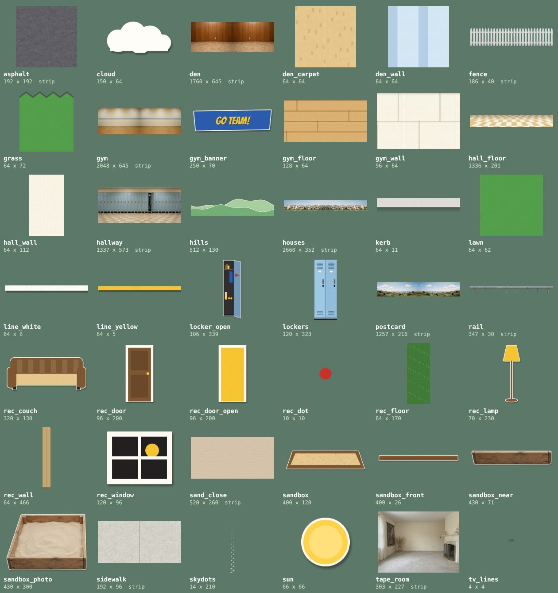
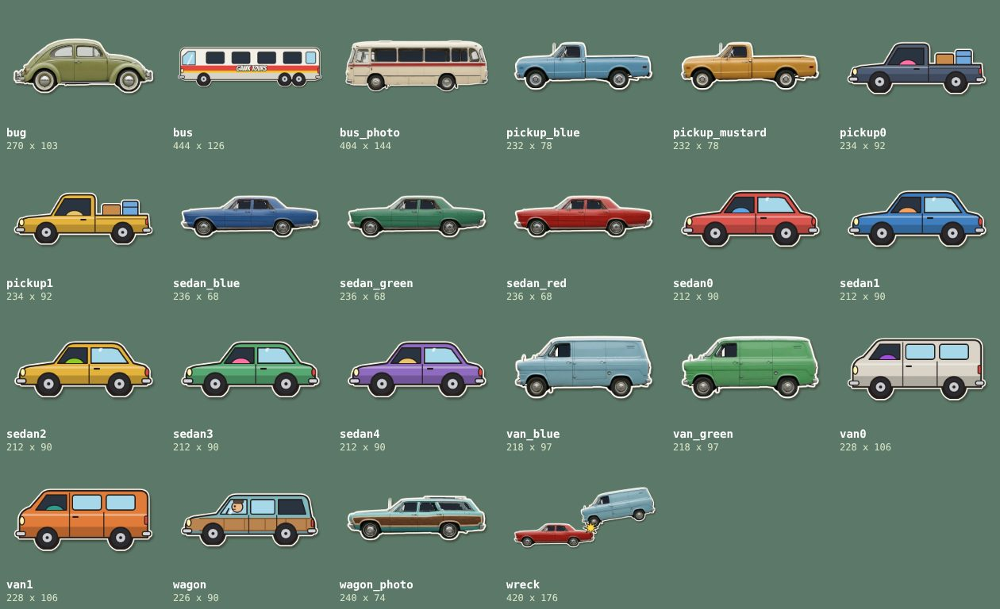
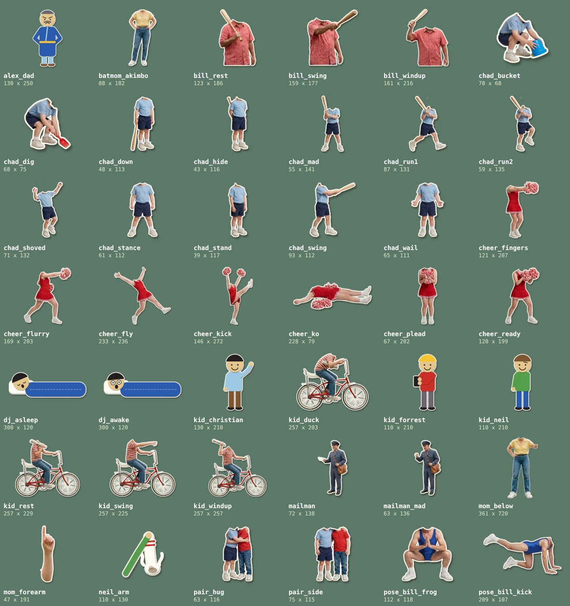
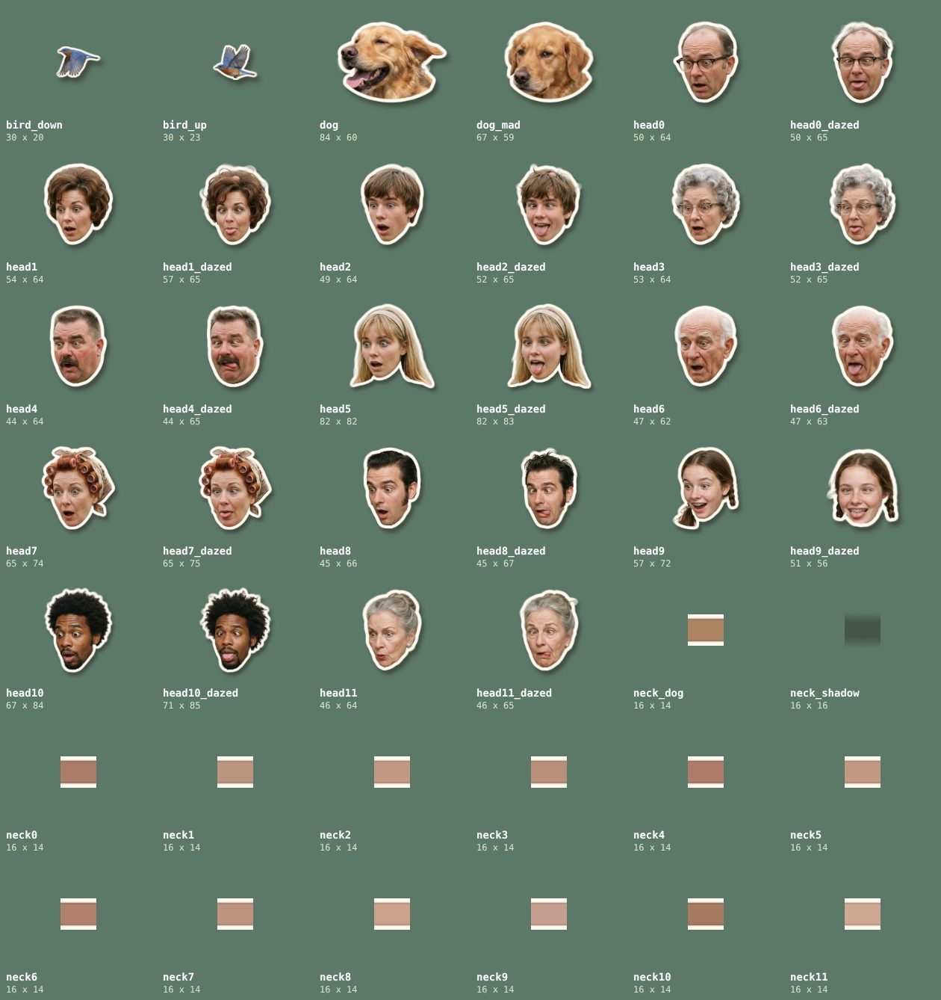
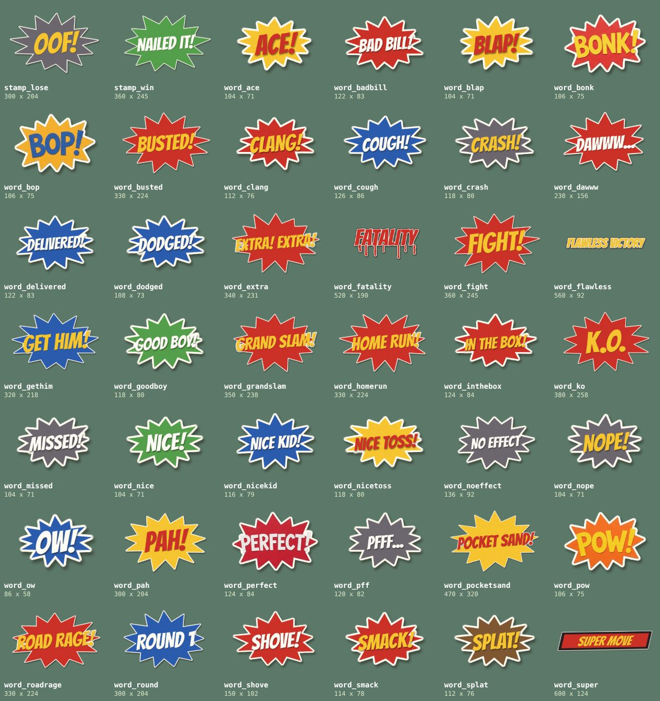
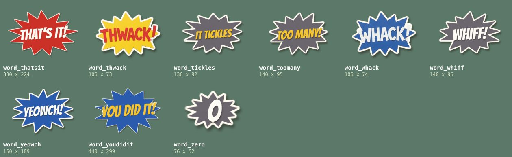

# The catalogue

Every picture the game has, by the name a game calls it by. **Made by `tools/test/catalogue.cjs`: do not edit by hand.** Run it again when pictures are added. How to use what is here: `docs/pictures.md`.

The size is how big the picture is drawn, in the game's own pixels (the page is 540 of them tall). A strip repeats to fill a width.

- [Places](#places) (52)
- [Things](#things) (51)
- [Cars](#cars) (22)
- [People: bodies](#bodies) (77)
- [People: faces](#faces) (32)
- [The rubberneckers, and the animals](#gawkers) (42)
- [Effects](#effects) (25)
- [Words on bursts](#words) (51)
- [The interface](#interface) (26)

## Places

Backdrops, and the strips some of them are made of. Each place is laid with one call: `src/minis/shared/places.ts`.

| Name | Size | |
| --- | --- | --- |
| `asphalt` | 192 x 192 | strip |
| `cloud` | 150 x 64 |  |
| `den` | 1760 x 645 | strip |
| `den_carpet` | 64 x 64 |  |
| `den_wall` | 64 x 64 |  |
| `fence` | 186 x 40 | strip |
| `grass` | 64 x 72 |  |
| `gym` | 2048 x 645 | strip |
| `gym_banner` | 250 x 70 |  |
| `gym_floor` | 128 x 64 |  |
| `gym_wall` | 96 x 64 |  |
| `hall_floor` | 1336 x 201 |  |
| `hall_wall` | 64 x 112 |  |
| `hallway` | 1337 x 573 | strip |
| `hills` | 512 x 130 |  |
| `houses` | 2660 x 352 | strip |
| `kerb` | 64 x 11 |  |
| `lawn` | 64 x 62 |  |
| `line_white` | 64 x 6 |  |
| `line_yellow` | 64 x 5 |  |
| `locker_open` | 106 x 339 |  |
| `lockers` | 120 x 323 |  |
| `postcard` | 1257 x 216 | strip |
| `rail` | 347 x 30 | strip |
| `rec_couch` | 320 x 130 |  |
| `rec_door` | 96 x 200 |  |
| `rec_door_open` | 96 x 200 |  |
| `rec_dot` | 10 x 10 |  |
| `rec_floor` | 64 x 170 |  |
| `rec_lamp` | 70 x 230 |  |
| `rec_wall` | 64 x 466 |  |
| `rec_window` | 120 x 96 |  |
| `sand_close` | 520 x 260 | strip |
| `sandbox` | 400 x 120 |  |
| `sandbox_front` | 400 x 26 |  |
| `sandbox_near` | 430 x 71 |  |
| `sandbox_photo` | 430 x 300 |  |
| `sidewalk` | 192 x 96 | strip |
| `skydots` | 14 x 210 |  |
| `sun` | 66 x 66 |  |
| `tape_room` | 303 x 227 | strip |
| `tv_lines` | 4 x 4 |  |
| `tv_set` | 440 x 432 |  |
| `tv_snow` | 128 x 128 |  |
| `yard_cloud` | 130 x 54 |  |
| `yard_fence` | 96 x 150 |  |
| `yard_grass` | 128 x 64 |  |
| `yard_ground` | 2392 x 323 | strip |
| `yard_house` | 470 x 476 |  |
| `yard_sky` | 64 x 64 |  |
| `yard_sky_photo` | 2392 x 361 | strip |
| `yard_sun` | 90 x 90 |  |

## Things

What can be put in a place, picked up, thrown or broken.

| Name | Size | |
| --- | --- | --- |
| `armphone` | 54 x 59 |  |
| `bake_table` | 250 x 120 |  |
| `bat` | 84 x 18 |  |
| `billboard0` | 123 x 152 |  |
| `billboard1` | 123 x 152 |  |
| `birdhouse` | 62 x 62 |  |
| `bleachers` | 380 x 183 |  |
| `blob` | 18 x 12 |  |
| `book` | 84 x 108 |  |
| `cal_page` | 104 x 110 |  |
| `cassette` | 200 x 70 |  |
| `cone` | 19 x 33 |  |
| `crack` | 130 x 44 |  |
| `cupcake` | 26 x 28 |  |
| `hand_grab` | 151 x 430 |  |
| `hand_throw` | 340 x 138 |  |
| `hoop` | 170 x 340 |  |
| `jar` | 53 x 86 |  |
| `mailbox0` | 55 x 88 |  |
| `mailbox0_hit` | 65 x 93 |  |
| `mailbox1` | 55 x 88 |  |
| `mailbox1_hit` | 65 x 93 |  |
| `palm` | 66 x 172 |  |
| `paper_roll` | 30 x 12 |  |
| `phone` | 7 x 26 |  |
| `phone_glow` | 60 x 60 |  |
| `plank` | 64 x 12 |  |
| `rock` | 30 x 24 |  |
| `sand_blob` | 66 x 41 |  |
| `sand_bucket` | 31 x 36 |  |
| `sand_clump` | 30 x 19 |  |
| `sand_heap` | 66 x 41 |  |
| `sand_pile` | 250 x 157 |  |
| `sand_shovel` | 27 x 50 |  |
| `sand_speck` | 13 x 8 |  |
| `sandcastle` | 39 x 52 |  |
| `shake` | 53 x 104 |  |
| `sign0` | 87 x 167 |  |
| `sign1` | 87 x 167 |  |
| `splat0` | 120 x 124 |  |
| `splat1` | 120 x 131 |  |
| `splat2` | 120 x 124 |  |
| `splat3` | 120 x 125 |  |
| `switch_off` | 22 x 34 |  |
| `switch_on` | 22 x 34 |  |
| `tree` | 370 x 341 |  |
| `yard_bush` | 139 x 112 |  |
| `yard_line` | 254 x 205 |  |
| `yard_pool` | 200 x 79 |  |
| `yard_swing` | 239 x 240 |  |
| `yard_tree` | 271 x 310 |  |

## Cars

From the highway. A photo one and a paper one of most.

| Name | Size | |
| --- | --- | --- |
| `bug` | 270 x 103 |  |
| `bus` | 444 x 126 |  |
| `bus_photo` | 404 x 144 |  |
| `pickup_blue` | 232 x 78 |  |
| `pickup_mustard` | 232 x 78 |  |
| `pickup0` | 234 x 92 |  |
| `pickup1` | 234 x 92 |  |
| `sedan_blue` | 236 x 68 |  |
| `sedan_green` | 236 x 68 |  |
| `sedan_red` | 236 x 68 |  |
| `sedan0` | 212 x 90 |  |
| `sedan1` | 212 x 90 |  |
| `sedan2` | 212 x 90 |  |
| `sedan3` | 212 x 90 |  |
| `sedan4` | 212 x 90 |  |
| `van_blue` | 218 x 97 |  |
| `van_green` | 218 x 97 |  |
| `van0` | 228 x 106 |  |
| `van1` | 228 x 106 |  |
| `wagon` | 226 x 90 |  |
| `wagon_photo` | 240 x 74 |  |
| `wreck` | 420 x 176 |  |

## People: bodies

Each is one pose. The family's have no heads: a face is hung on by the chin (`docs/characters.md`).

| Name | Size | |
| --- | --- | --- |
| `alex_dad` | 130 x 250 |  |
| `batmom_akimbo` | 88 x 182 |  |
| `bill_rest` | 123 x 186 |  |
| `bill_swing` | 159 x 177 |  |
| `bill_windup` | 161 x 216 |  |
| `chad_bucket` | 70 x 68 |  |
| `chad_dig` | 68 x 75 |  |
| `chad_down` | 48 x 113 |  |
| `chad_hide` | 43 x 116 |  |
| `chad_mad` | 55 x 141 |  |
| `chad_run1` | 87 x 131 |  |
| `chad_run2` | 59 x 135 |  |
| `chad_shoved` | 71 x 132 |  |
| `chad_stance` | 61 x 112 |  |
| `chad_stand` | 39 x 117 |  |
| `chad_swing` | 93 x 112 |  |
| `chad_wail` | 65 x 111 |  |
| `cheer_fingers` | 121 x 207 |  |
| `cheer_flurry` | 169 x 203 |  |
| `cheer_fly` | 233 x 236 |  |
| `cheer_kick` | 146 x 272 |  |
| `cheer_ko` | 228 x 79 |  |
| `cheer_plead` | 67 x 202 |  |
| `cheer_ready` | 120 x 199 |  |
| `dj_asleep` | 300 x 120 |  |
| `dj_awake` | 300 x 120 |  |
| `kid_christian` | 130 x 210 |  |
| `kid_duck` | 257 x 203 |  |
| `kid_forrest` | 110 x 210 |  |
| `kid_neil` | 110 x 210 |  |
| `kid_rest` | 257 x 229 |  |
| `kid_swing` | 257 x 225 |  |
| `kid_windup` | 257 x 257 |  |
| `mailman` | 72 x 138 |  |
| `mailman_mad` | 63 x 136 |  |
| `mom_below` | 361 x 720 |  |
| `mom_forearm` | 47 x 191 |  |
| `neil_arm` | 110 x 130 |  |
| `pair_hug` | 63 x 116 |  |
| `pair_side` | 75 x 115 |  |
| `pose_bill_frog` | 112 x 118 |  |
| `pose_bill_kick` | 209 x 107 |  |
| `pose_bill_lunge` | 167 x 178 |  |
| `pose_bill_pretzel` | 187 x 94 |  |
| `pose_bill_ready` | 96 x 173 |  |
| `pose_bill_stretch` | 67 x 285 |  |
| `pose_mom_frog` | 116 x 117 |  |
| `pose_mom_kick` | 182 x 106 |  |
| `pose_mom_lunge` | 165 x 175 |  |
| `pose_mom_pretzel` | 174 x 92 |  |
| `pose_mom_ready` | 94 x 170 |  |
| `pose_mom_stretch` | 65 x 279 |  |
| `rival_arm0` | 182 x 354 |  |
| `rival_arm1` | 203 x 356 |  |
| `rival_arm2` | 203 x 356 |  |
| `rival_arm3` | 163 x 382 |  |
| `rival_charge` | 118 x 287 |  |
| `rival_flick` | 222 x 346 |  |
| `rival_flinch` | 127 x 287 |  |
| `rival_hulk` | 172 x 356 |  |
| `rival_point` | 151 x 286 |  |
| `rival_walk` | 123 x 283 |  |
| `rival_win` | 120 x 344 |  |
| `shane_above` | 382 x 640 |  |
| `shane_bawl` | 47 x 117 |  |
| `shane_good` | 46 x 116 |  |
| `shane_laugh` | 60 x 115 |  |
| `shane_ow` | 90 x 114 |  |
| `shane_punch` | 75 x 121 |  |
| `shane_push` | 90 x 117 |  |
| `shane_reach` | 58 x 114 |  |
| `shane_run1` | 93 x 107 |  |
| `shane_run2` | 66 x 111 |  |
| `shane_throw` | 80 x 125 |  |
| `teen_rest` | 393 x 305 |  |
| `teen_swing` | 300 x 342 |  |
| `teen_windup` | 482 x 218 |  |

## People: faces

The family's heads. Who has which look, and which are missing, is in `docs/characters.md`.

| Name | Size | |
| --- | --- | --- |
| `bill_hold` | 72 x 96 |  |
| `bill_in` | 72 x 97 |  |
| `bill_pah` | 72 x 103 |  |
| `bill-back` | 205 x 274 |  |
| `bill-glare` | 186 x 248 |  |
| `bill-grin` | 196 x 248 |  |
| `bill-sideeye` | 190 x 248 |  |
| `chadbighead_set` | 181 x 283 |  |
| `chadbighead_yell` | 183 x 318 |  |
| `chadhead_angel` | 44 x 63 |  |
| `chadhead_cry` | 44 x 67 |  |
| `chadhead_glee` | 41 x 62 |  |
| `chadhead_joy` | 42 x 63 |  |
| `chadhead_mad` | 46 x 63 |  |
| `chadhead_sad` | 46 x 63 |  |
| `chadhead_set` | 40 x 63 |  |
| `chadhead_yell` | 41 x 70 |  |
| `mom_big_scold` | 271 x 299 |  |
| `mom_hold` | 102 x 115 |  |
| `mom_in` | 102 x 116 |  |
| `mom_pah` | 102 x 116 |  |
| `mom_scold` | 104 x 115 |  |
| `mom_smile` | 102 x 116 |  |
| `shanebighead_cry` | 179 x 281 |  |
| `shanebighead_doe` | 189 x 285 |  |
| `shanehead_cry` | 40 x 62 |  |
| `shanehead_doe` | 42 x 63 |  |
| `shanehead_grin` | 42 x 62 |  |
| `shanehead_ow` | 40 x 63 |  |
| `shanehead_scared` | 40 x 63 |  |
| `shanehead_sweet` | 39 x 62 |  |
| `shanehead_tongue` | 39 x 62 |  |

## The rubberneckers, and the animals

Twelve heads, each gawking and dazed, with a neck the colour of each; the dog; the bluebirds.

| Name | Size | |
| --- | --- | --- |
| `bird_down` | 30 x 20 |  |
| `bird_up` | 30 x 23 |  |
| `dog` | 84 x 60 |  |
| `dog_mad` | 67 x 59 |  |
| `head0` | 50 x 64 |  |
| `head0_dazed` | 50 x 65 |  |
| `head1` | 54 x 64 |  |
| `head1_dazed` | 57 x 65 |  |
| `head2` | 49 x 64 |  |
| `head2_dazed` | 52 x 65 |  |
| `head3` | 53 x 64 |  |
| `head3_dazed` | 52 x 65 |  |
| `head4` | 44 x 64 |  |
| `head4_dazed` | 44 x 65 |  |
| `head5` | 82 x 82 |  |
| `head5_dazed` | 82 x 83 |  |
| `head6` | 47 x 62 |  |
| `head6_dazed` | 47 x 63 |  |
| `head7` | 65 x 74 |  |
| `head7_dazed` | 65 x 75 |  |
| `head8` | 45 x 66 |  |
| `head8_dazed` | 45 x 67 |  |
| `head9` | 57 x 72 |  |
| `head9_dazed` | 51 x 56 |  |
| `head10` | 67 x 84 |  |
| `head10_dazed` | 71 x 85 |  |
| `head11` | 46 x 64 |  |
| `head11_dazed` | 46 x 65 |  |
| `neck_dog` | 16 x 14 |  |
| `neck_shadow` | 16 x 16 |  |
| `neck0` | 16 x 14 |  |
| `neck1` | 16 x 14 |  |
| `neck2` | 16 x 14 |  |
| `neck3` | 16 x 14 |  |
| `neck4` | 16 x 14 |  |
| `neck5` | 16 x 14 |  |
| `neck6` | 16 x 14 |  |
| `neck7` | 16 x 14 |  |
| `neck8` | 16 x 14 |  |
| `neck9` | 16 x 14 |  |
| `neck10` | 16 x 14 |  |
| `neck11` | 16 x 14 |  |

## Effects

Small things that fly, flash or float.

| Name | Size | |
| --- | --- | --- |
| `alert` | 34 x 44 |  |
| `aura` | 300 x 380 |  |
| `breath` | 28 x 8 |  |
| `burst` | 130 x 112 |  |
| `dash` | 110 x 8 |  |
| `edge` | 8 x 14 |  |
| `eyes` | 30 x 12 |  |
| `halo` | 50 x 20 |  |
| `heart` | 30 x 28 |  |
| `heart_off` | 30 x 28 |  |
| `puff` | 40 x 42 |  |
| `shadow` | 70 x 22 |  |
| `shred_cloth` | 20 x 14 |  |
| `shred_red` | 18 x 6 |  |
| `shred_white` | 18 x 6 |  |
| `spark` | 12 x 12 |  |
| `sparkle` | 44 x 44 |  |
| `speed_lines` | 700 x 700 |  |
| `star` | 27 x 26 |  |
| `star_big` | 84 x 81 |  |
| `star_big_off` | 84 x 81 |  |
| `steam` | 44 x 36 |  |
| `tear` | 16 x 24 |  |
| `zone` | 84 x 84 |  |
| `zzz` | 70 x 56 |  |

## Words on bursts

Shown with `this.host.word('bonk', x, y)`: the name without "word_".

| Name | Size | |
| --- | --- | --- |
| `stamp_lose` | 300 x 204 |  |
| `stamp_win` | 360 x 245 |  |
| `word_ace` | 104 x 71 |  |
| `word_badbill` | 122 x 83 |  |
| `word_blap` | 104 x 71 |  |
| `word_bonk` | 106 x 75 |  |
| `word_bop` | 106 x 75 |  |
| `word_busted` | 330 x 224 |  |
| `word_clang` | 112 x 76 |  |
| `word_cough` | 126 x 86 |  |
| `word_crash` | 118 x 80 |  |
| `word_dawww` | 230 x 156 |  |
| `word_delivered` | 122 x 83 |  |
| `word_dodged` | 108 x 73 |  |
| `word_extra` | 340 x 231 |  |
| `word_fatality` | 520 x 190 |  |
| `word_fight` | 360 x 245 |  |
| `word_flawless` | 560 x 92 |  |
| `word_gethim` | 320 x 218 |  |
| `word_goodboy` | 118 x 80 |  |
| `word_grandslam` | 350 x 238 |  |
| `word_homerun` | 330 x 224 |  |
| `word_inthebox` | 124 x 84 |  |
| `word_ko` | 380 x 258 |  |
| `word_missed` | 104 x 71 |  |
| `word_nice` | 104 x 71 |  |
| `word_nicekid` | 116 x 79 |  |
| `word_nicetoss` | 118 x 80 |  |
| `word_noeffect` | 136 x 92 |  |
| `word_nope` | 104 x 71 |  |
| `word_ow` | 86 x 58 |  |
| `word_pah` | 300 x 204 |  |
| `word_perfect` | 124 x 84 |  |
| `word_pff` | 120 x 82 |  |
| `word_pocketsand` | 470 x 320 |  |
| `word_pow` | 106 x 75 |  |
| `word_roadrage` | 330 x 224 |  |
| `word_round` | 300 x 204 |  |
| `word_shove` | 150 x 102 |  |
| `word_smack` | 114 x 78 |  |
| `word_splat` | 112 x 76 |  |
| `word_super` | 600 x 124 |  |
| `word_thatsit` | 330 x 224 |  |
| `word_thwack` | 106 x 73 |  |
| `word_tickles` | 136 x 92 |  |
| `word_toomany` | 140 x 95 |  |
| `word_whack` | 106 x 74 |  |
| `word_whiff` | 140 x 95 |  |
| `word_yeowch` | 160 x 109 |  |
| `word_youdidit` | 440 x 299 |  |
| `word_zero` | 76 x 52 |  |

## The interface

Buttons, tape, meters and marks.

| Name | Size | |
| --- | --- | --- |
| `btn_duck` | 124 x 124 |  |
| `btn_rage` | 124 x 124 |  |
| `btn_rage_off` | 124 x 124 |  |
| `choice_x` | 120 x 70 |  |
| `fight_btn` | 260 x 58 |  |
| `fight_btn_sad` | 260 x 58 |  |
| `lungs` | 40 x 200 |  |
| `meter` | 312 x 30 |  |
| `meter_green` | 32 x 18 |  |
| `meter_red` | 32 x 18 |  |
| `mini_mark` | 26 x 26 |  |
| `mini_mark_ko` | 26 x 26 |  |
| `mini_mark_lose` | 26 x 26 |  |
| `mini_mark_now` | 26 x 26 |  |
| `mini_mark_win` | 26 x 26 |  |
| `pose_card` | 96 x 104 |  |
| `pose_card_on` | 96 x 104 |  |
| `snd_off` | 36 x 36 |  |
| `snd_on` | 36 x 36 |  |
| `tag` | 96 x 32 |  |
| `tape_l` | 470 x 40 |  |
| `tape_m` | 168 x 30 |  |
| `tape_s` | 78 x 26 |  |
| `title_card` | 440 x 232 |  |
| `title_sub` | 290 x 50 |  |
| `you_are` | 250 x 44 |  |
